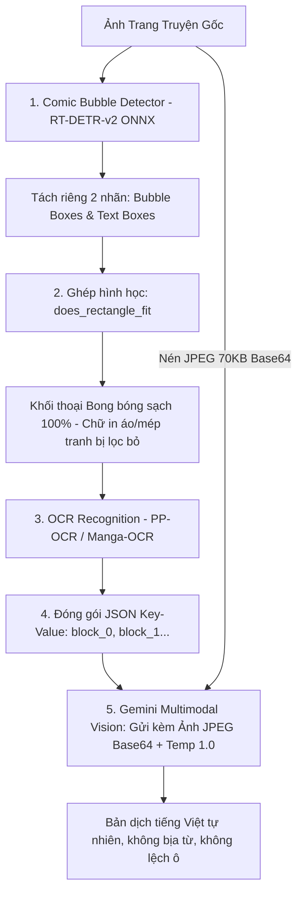

# 📚 TÀI LIỆU PHÂN TÍCH KIẾN TRÚC MẪU: COMIC TRANSLATE (D:\comic-translate-main)

> **Mục đích:** Ghi nhận và bảo toàn 100% ngữ cảnh kiến trúc, cấu hình, mã nguồn và thuật toán của dự án mã nguồn mở `comic-translate-main` (tại `D:\comic-translate-main`) để làm kim chỉ nam nâng cấp triệt để cho hệ thống `comic-translate-vn`.

---

## 🗺️ 1. SƠ ĐỒ TỔNG THỂ KIẾN TRÚC



---

## 🧩 2. CHI TIẾT TỪNG MODULE TRONG MÃ NGUỒN CỦA HỌ

### 2.1. Module Phát hiện Bong bóng Thoại (Text & Bubble Detection)
* **Đường dẫn tệp:**
  * `D:\comic-translate-main\modules\detection\rtdetr_v2_onnx.py`
  * `D:\comic-translate-main\modules\detection\base.py`
* **Vị trí file Model có sẵn trên máy:**
  `C:\Users\LENOVO\AppData\Local\ComicTranslate\models\detection\detector.onnx` (168 MB)

#### Cơ chế hoạt động:
1. **Model RT-DETR-v2 chạy ở độ phân giải cố định 640x640:**
   ```python
   # modules/detection/rtdetr_v2_onnx.py (dòng 68-71)
   im_resized = pil_image.resize((640, 640))
   arr = np.asarray(im_resized, dtype=np.float32) / 255.0
   arr = np.transpose(arr, (2, 0, 1))
   im_data = arr[np.newaxis, ...]
   ```
2. **Tách biệt 2 loại đối tượng rõ ràng (`labels`):**
   ```python
   # modules/detection/rtdetr_v2_onnx.py (dòng 97-101)
   label_id = int(lab)
   if label_id == 0:
       bubble_boxes.append([x1, y1, x2, y2])  # Bong bóng thoại của nhân vật
   elif label_id in [1, 2]:
       text_boxes.append([x1, y1, x2, y2])    # Chữ
   ```
3. **Quy tắc gom chữ vào bóng thoại (`does_rectangle_fit`):**
   ```python
   # modules/detection/base.py (dòng 99-109)
   for bble_box in bubble_boxes:
       if does_rectangle_fit(bble_box, txt_box):
           # Chữ nằm trọn trong bóng thoại
           text_blocks.append(TextBlock(text_bbox=txt_box, bubble_bbox=bble_box, text_class='text_bubble'))
           text_matched[txt_idx] = True
           break
   
   # Chữ KHÔNG nằm trong bóng thoại (như chữ in trên ngực áo, logo mép tranh)
   if not text_matched[txt_idx]:
       text_blocks.append(TextBlock(text_bbox=txt_box, text_class='text_free'))
   ```
> **Ý nghĩa quyết định:** Chữ in trên ngực áo (`NUMBER GIRL`) không có bong bóng bao quanh, nên được phân loại là `text_free` và **tuyệt đối không bao giờ bị gom nhầm vào bóng thoại của nhân vật**.

---

### 2.2. Module Dịch thuật LLM & Gemini Multimodal Vision
* **Đường dẫn tệp:**
  * `D:\comic-translate-main\modules\translation\llm\base.py`
  * `D:\comic-translate-main\modules\translation\llm\gemini.py`
  * `D:\comic-translate-main\modules\translation\base.py`
  * `D:\comic-translate-main\modules\utils\translator_utils.py`

#### Tham số cấu hình AI:
```python
# modules/translation/llm/base.py (dòng 39-41)
self.img_as_llm_input = True   # LUÔN GỬI KÈM ẢNH (Multimodal Vision)
self.temperature = 1.0         # Nhiệt độ cao để câu văn phóng khoáng, giàu cảm xúc
self.max_tokens = 5000
```

#### Cách gửi ảnh sang Gemini (Cực nhẹ, không hề nặng):
```python
# modules/translation/llm/gemini.py (dòng 78-87)
if self.img_as_llm_input:
    # Nén ảnh thành JPEG (chỉ ~60-90 KB) rồi encode base64
    img_b64, mime_type = self.encode_image(image, ext=".jpg")
    parts.append({
        "inline_data": {
            "mime_type": mime_type,
            "data": img_b64
        }
    })

# Gửi kèm User Prompt
parts.append({"text": user_prompt})
```
* **Chi phí tài nguyên:** 1 ảnh nén JPEG gửi lên Gemini Flash chỉ tiêu tốn **~258 tokens**.
* **Lợi ích:** Gemini có "đôi mắt" nhìn thấy biểu cảm, trang phục, nhân vật nam/nữ, bối cảnh nên dù để `temperature = 1.0` nó vẫn dịch chuẩn xác 100%, không bao giờ đoán mò hay bịa từ.

---

### 2.3. System Prompt "Thần Thánh" (Ngắn gọn - Hiệu quả)
```text
You are an expert translator who translates {source_lang} to {target_lang}. You pay attention to style, formality, idioms, slang etc and try to convey it in the way a {target_lang} speaker would understand.
BE MORE NATURAL. NEVER USE 당신, 그녀, 그 or its Japanese equivalents.
Specifically, you will be translating text OCR'd from a comic. The OCR is not perfect and as such you may receive text with typos or other mistakes.
To aid you and provide context, You may be given the image of the page and/or extra context about the comic. You will be given a json string of the detected text blocks and the text to translate. Return the json string with the texts translated. DO NOT translate the keys of the json. For each block:
- If it's already in {target_lang} or looks like gibberish, OUTPUT IT AS IT IS instead
- DO NOT give explanations
Do Your Best! I'm really counting on you.
```

> **Dòng code then chốt chặn đứng lỗi bịa từ:**  
> `"- If it's already in {target_lang} or looks like gibberish, OUTPUT IT AS IT IS instead"`  
> *(Nếu chữ trông giống như rác hoặc vô nghĩa, HÃY GIỮ NGUYÊN NÓ, CẤM DỊCH!)*  
> Nhờ dòng này, các chuỗi chữ in áo rách nét như `HMEESGR` được giữ nguyên chứ không bao giờ bị AI bịa thành `"3 nhé"` hay `"sột so"`.

---

### 2.4. Cấu trúc JSON Tinh gọn (Key-Value)
Trong `modules/utils/translator_utils.py`:

* **Dữ liệu gửi lên AI (`get_raw_text`):**
  ```json
  {
      "block_0": "8月31日のロングサマー 刮鬍刀",
      "block_1": "鈴木君會長鬍子嗎？",
      "block_2": "那當然是會長的哦"
  }
  ```

* **Dữ liệu AI trả về (`set_texts_from_json`):**
  ```json
  {
      "block_0": "Mùa hè dài ngày 31 tháng 8: Dao cạo râu",
      "block_1": "Suzuki này, cậu có mọc râu không?",
      "block_2": "Tất nhiên là có rồi."
  }
  ```
* Bóc tách an toàn bằng Regex: `re.search(r"\{[\s\S]*\}", json_string)` rồi map trực tiếp `block_{idx}` vào từng `TextBlock`.

---

## ⚖️ 3. BẢNG SO SÁNH GIỮA HAI HỆ THỐNG

| Tiêu chí | `comic-translate-main` (Họ) | `comic-translate-vn` (Hiện tại) | Đánh giá & Hướng khắc phục |
| :--- | :--- | :--- | :--- |
| **Phát hiện Bounding Box** | Model AI **RT-DETR-v2** chuyên biệt nhận diện bong bóng thoại | PaddleOCR văn phòng (`PP-OCRv5_det`) + Đo khoảng cách pixel thủ công | **Điểm yếu chí mạng của ta.** Cần thay bằng `detector.onnx` để bóc bóng thoại chuẩn 100%. |
| **Chữ ngoài lề / Chữ trên áo** | Tách riêng thành `text_free`, không dính vào thoại | Bị thuật toán đo pixel gom nhầm vào bóng thoại (`鈴木君...MBERGA`) | Khiến câu thoại bị dơ, làm hỏng câu dịch. |
| **Visual Context (Nhìn ảnh)** | **BẬT MẶC ĐỊNH** (Gửi kèm ảnh JPEG base64, ~258 tokens) | **TẮT** (Chỉ gửi text JSON mù) | Cần bật Multimodal Vision để Gemini có mắt nhìn biểu cảm nhân vật. |
| **Tham số Temperature** | `1.0` (Văn phong cực mượt vì có ảnh làm mỏ neo) | `0.2` (An toàn nhưng khô cứng) | Khi có ảnh và text sạch, nâng lên 0.7 - 1.0 sẽ cho văn phong người thật cực hay. |
| **Định dạng JSON** | Flat Dict `{"block_0": "..."}` | Array `[{"id": 0, "translation": "..."}]` | Dạng Flat Dict của họ nhẹ hơn 60% và chống gãy JSON tốt hơn. |
| **Luật chặn rác OCR** | Có luật: `looks like gibberish -> OUTPUT AS IT IS` | Không có luật này, AI cố dịch chữ rác | Bổ sung ngay dòng luật này vào prompt. |

---

## 🚀 4. KẾ HOẠCH NÂNG CẤP ĐỒNG BỘ CHO DỰ ÁN (MIGRATION ROADMAP)

### Giai đoạn 1: Nâng cấp Server Translator (Nhanh, không sợ lỗi)
1. Đổi format prompt sang dạng Dictionary `{"block_0": "..."}`.
2. Thêm rule: `looks like gibberish -> OUTPUT AS IT IS`.
3. Bổ sung `inline_data` gửi kèm ảnh thumbnail JPEG nén (~70KB) từ Server sang Gemini (Multimodal Vision).

### Giai đoạn 2: Tích hợp `detector.onnx` vào `ocr_service` (Bản 2.0 hoàn chỉnh)
1. Nhúng `InferenceSession` với `detector.onnx` (đã có sẵn trong AppData).
2. Tách lớp `bubble_boxes` và `text_boxes`.
3. Đảm bảo 100% chữ in áo và mép tranh bị cô lập, chỉ đưa chữ trong bóng thoại vào bản dịch.
